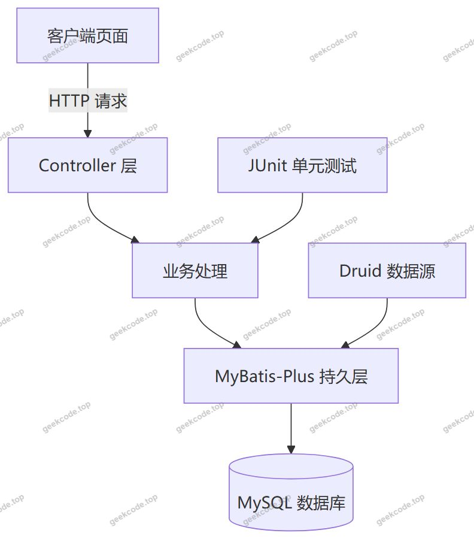
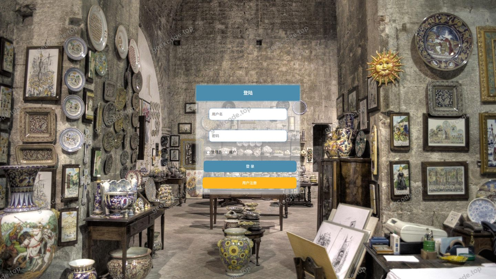
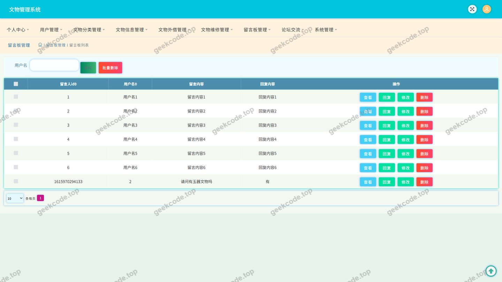
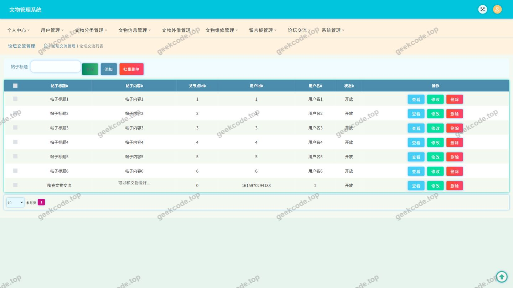
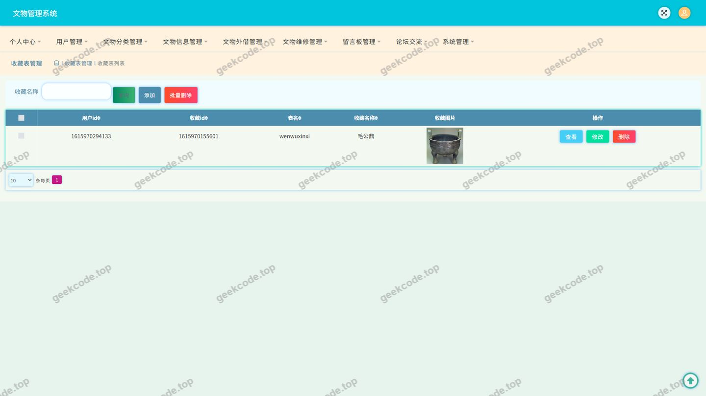
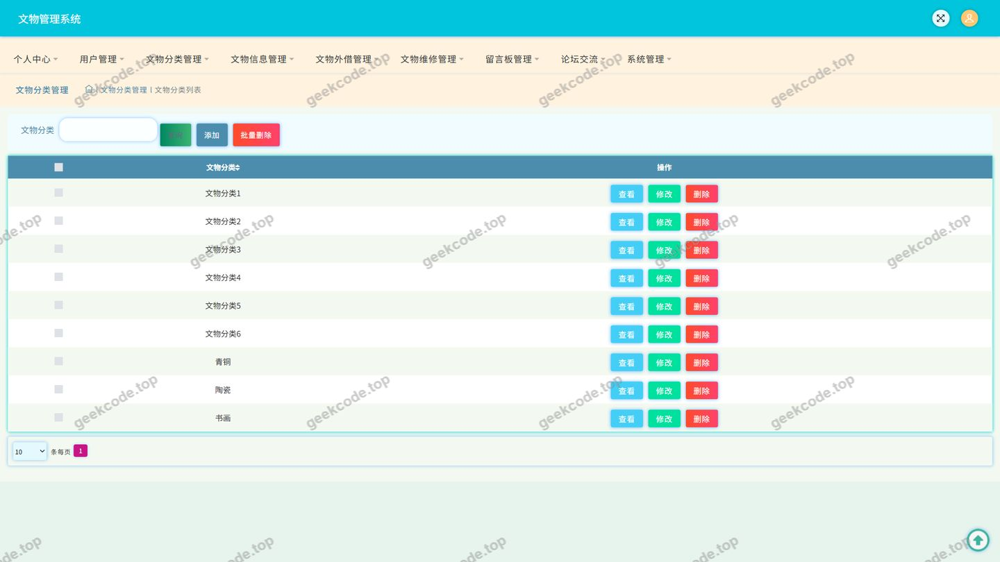
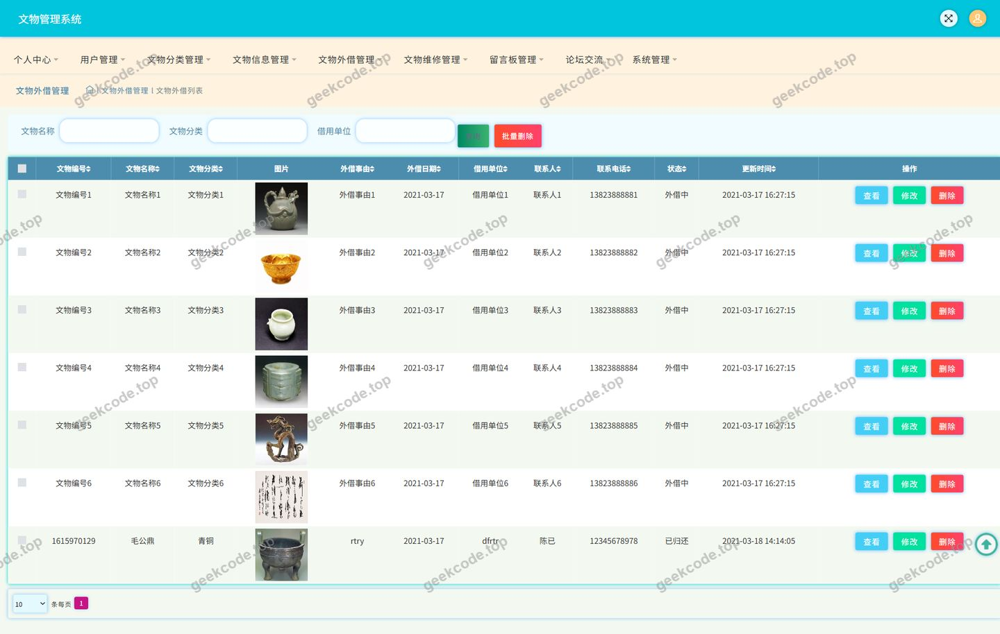
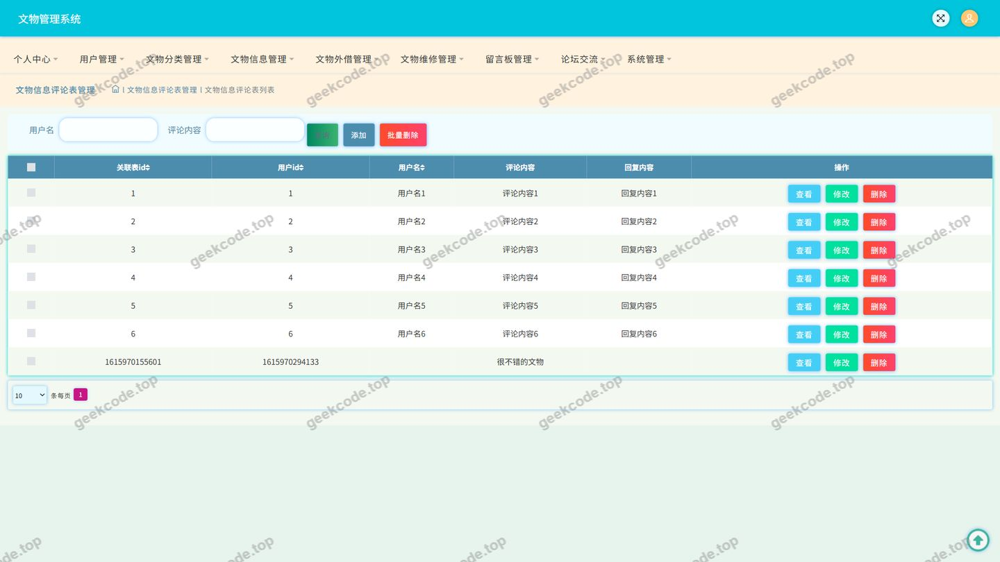
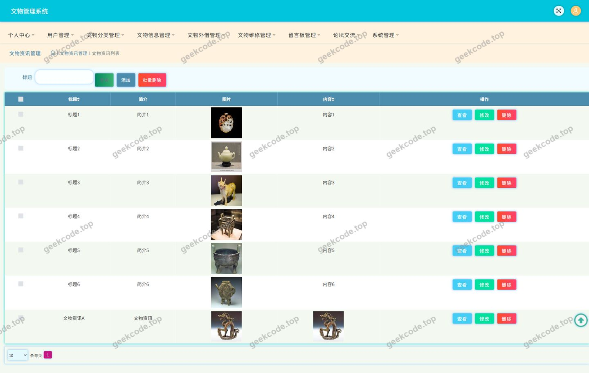
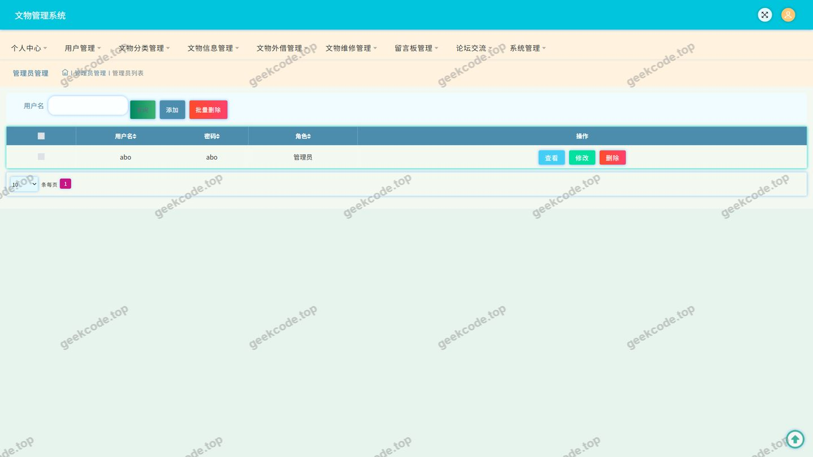

# java项目-ssm文物管理系统-计算机毕业设计-带论文

> 🎓 **计算机毕业设计 · java项目-ssm文物管理系统-计算机毕业设计-带论文**
>
> 本仓库只放**项目介绍 + 运行截图**（截图是站点带水印的原图，存在仓库 `images/` 里）。
>
> 👉 **完整可运行源码 / 数据库脚本 / 部署文档：[点我获取](https://geekcode.top/archives/java%E9%A1%B9%E7%9B%AE-ssm%E6%96%87%E7%89%A9%E7%AE%A1%E7%90%86%E7%B3%BB%E7%BB%9F-%E8%AE%A1%E7%AE%97%E6%9C%BA%E6%AF%95%E4%B8%9A%E8%AE%BE%E8%AE%A1-%E5%B8%A6%E8%AE%BA%E6%96%87?utm_source=github)**
>
> 💬 咨询微信：**ir9372**　|　🌐 更多项目：[极客代码 geekcode.top](https://geekcode.top/?utm_source=github)
>
> 📌 项目详情页：<https://geekcode.top/archives/java%E9%A1%B9%E7%9B%AE-ssm%E6%96%87%E7%89%A9%E7%AE%A1%E7%90%86%E7%B3%BB%E7%BB%9F-%E8%AE%A1%E7%AE%97%E6%9C%BA%E6%AF%95%E4%B8%9A%E8%AE%BE%E8%AE%A1-%E5%B8%A6%E8%AE%BA%E6%96%87?utm_source=github>

<table><td width="230" align="center"> <b>扫码加微信 ir9372</b></td><td valign="middle">📦 源码 = 项目介绍 + 全部运行截图 + 数据库 + 部署文档 👉 点上方任意截图，直接跳到 <b>极客代码 geekcode.top</b> 详情页</td></table>

---

<h1>java项目-ssm文物管理系统-计算机毕业设计-带论文</h1>
<h2>项目概述</h2>

文物管理系统是一套面向文博业务场景的信息化管理平台，项目全称为「SSM 文物管理系统」，属于计算机专业毕业设计项目，采用纯后端接口（pure-api）形态交付，附带毕业论文。系统围绕文物的登记、分类、外借、维修等核心业务展开，同时提供文物资讯、论坛交流、留言反馈、收藏等互动功能，形成&quot;业务管理 + 信息交流&quot;的一体化解决方案。

系统核心功能包括：文物信息管理与评论、文物分类管理、文物外借管理、文物维修管理、论坛交流、文物资讯发布、留言反馈、收藏管理、用户管理以及文件上传与系统配置。前端页面通过登录、文物信息评论、论坛交流、留言板、文物资讯、收藏、用户、文物分类、文物外借等界面与后端接口交互。

技术架构采用 Spring + SpringMVC + MyBatis-Plus 的分层结构，数据源使用 Druid 连接池，单元测试使用 JUnit。项目适用人群为：文博机构的工作人员与管理人员、需要浏览文物资讯并参与交流的普通注册用户，以及需要参考同类系统设计与实现的计算机专业学生与开发者。

<h2>技术架构</h2>
<h3>整体架构</h3>

项目为纯 API 型项目，不包含前台与后台的路由配置，业务能力通过 Controller 层统一对外暴露接口，由客户端页面调用。现有信息未提供前端框架选型，截图中的页面为浏览器端界面。

<h3>后端分层</h3>
<ul>
<li><strong>Web 层</strong>：由 SpringMVC 承担请求映射与响应处理，依赖 <code>spring-web</code>、<code>spring-webmvc</code>。</li>
<li><strong>容器与装配层</strong>：由 Spring 核心容器负责 Bean 管理与依赖注入，依赖 <code>spring-core</code>、<code>spring-beans</code>、<code>spring-context</code>、<code>spring-context-support</code>。</li>
<li><strong>事务层</strong>：由 <code>spring-tx</code> 统一管理事务边界；<code>spring-jdbc</code> 提供 JDBC 抽象支撑。</li>
<li><strong>切面层</strong>：由 <code>spring-aop</code> 提供面向切面能力。</li>
<li><strong>持久层</strong>：由 MyBatis-Plus 承担数据访问，简化单表 CRUD 与条件查询。</li>
<li><strong>数据源层</strong>：由 Druid 提供数据库连接池能力。</li>
</ul>
<h3>Controller 组成</h3>
<table>
<thead>
<tr>
<th>控制器</th>
<th>对应业务</th>
</tr>
</thead>
<tbody><tr>
<td>CommonController</td>
<td>通用接口，承担跨模块公共请求处理</td>
</tr>
<tr>
<td>ConfigController</td>
<td>系统配置相关接口</td>
</tr>
<tr>
<td>UserController</td>
<td>用户相关接口</td>
</tr>
<tr>
<td>WenwufenleiController</td>
<td>文物分类相关接口</td>
</tr>
<tr>
<td>WenwuweixiuController</td>
<td>文物维修相关接口</td>
</tr>
<tr>
<td>WenwuwaijieController</td>
<td>文物外借相关接口</td>
</tr>
<tr>
<td>DiscusswenwuxinxiController</td>
<td>文物信息评论相关接口</td>
</tr>
<tr>
<td>ForumController</td>
<td>论坛交流相关接口</td>
</tr>
<tr>
<td>NewsController</td>
<td>文物资讯相关接口</td>
</tr>
<tr>
<td>MessagesController</td>
<td>留言反馈相关接口</td>
</tr>
<tr>
<td>StoreupController</td>
<td>收藏相关接口</td>
</tr>
<tr>
<td>FileController</td>
<td>文件上传与访问相关接口</td>
</tr>
</tbody></table>
<h3>数据库设计要点</h3>

结合控制器与页面菜单，系统数据实体主要覆盖以下方向：

<ul>
<li><strong>用户数据</strong>：账号、登录凭证与用户基础信息，支撑登录与个人中心。</li>
<li><strong>文物业务数据</strong>：文物分类数据（wenwufenlei）、文物信息数据（wenwuxinxi）、文物外借数据（wenwuwaijie）、文物维修数据（wenwuweixiu），构成文博业务主线。</li>
<li><strong>互动数据</strong>：文物信息评论（discusswenwuxinxi）、论坛交流（forum）、留言反馈（messages）、收藏记录（storeup）、文物资讯（news）。</li>
<li><strong>支撑数据</strong>：系统配置（config）与上传文件记录（file）。</li>
</ul>

设计上以文物分类为文物信息的归类依据，以外借、维修记录关联具体文物，以评论、收藏关联用户与文物信息，形成以文物为主体的关联结构。具体表结构字段与索引设计在现有信息中未提供。

<h3>核心技术选型理由</h3>
<ul>
<li><strong>Spring + SpringMVC</strong>：提供成熟的 IoC/AOP 与 MVC 能力，分层清晰，便于毕业设计中的模块划分与代码组织。</li>
<li><strong>MyBatis-Plus</strong>：在 MyBatis 基础上提供通用 CRUD 与条件构造能力，减少文物分类、资讯、留言等大量基础数据表的重复 SQL，提升开发效率。</li>
<li><strong>Druid</strong>：作为连接池组件，具备连接池监控与稳定性优势，适配中小型管理系统的并发访问需求。</li>
<li><strong>JUnit</strong>：提供单元测试支持，保障核心逻辑的正确性。</li>
</ul>
<h2>功能模块</h2>
<h3>前台用户端</h3>
<ul>
<li><strong>用户登录</strong>：提供用户身份验证入口，登录后可进入个人中心。</li>
<li><strong>文物信息</strong>：浏览文物信息列表与详情，并支持对文物信息发表评论。</li>
<li><strong>文物信息评论</strong>：针对具体文物信息提交评论内容，形成文物信息的互动讨论。</li>
<li><strong>文物分类</strong>：按文物分类维度查看文物信息。</li>
<li><strong>文物外借</strong>：查看文物外借相关信息。</li>
<li><strong>论坛交流</strong>：用户发布交流内容并浏览他人帖子，形成社区化交流。</li>
<li><strong>文物资讯</strong>：浏览文物资讯内容。</li>
<li><strong>留言反馈</strong>：提交留言反馈信息。</li>
<li><strong>收藏</strong>：对文物信息等对象进行收藏与取消收藏操作。</li>
<li><strong>个人中心</strong>：维护个人基础信息。</li>
<li><strong>我的发布</strong>：查看本人发布的内容记录。</li>
<li><strong>我的收藏</strong>：查看本人收藏的内容记录。</li>
</ul>
<h3>后台管理端</h3>
<ul>
<li><strong>用户管理</strong>：对系统用户数据进行维护。</li>
<li><strong>文物分类管理</strong>：维护文物分类数据，为文物信息提供分类基础。</li>
<li><strong>文物信息管理</strong>：维护文物信息数据，并管理文物信息评论内容。</li>
<li><strong>文物外借管理</strong>：维护文物外借记录。</li>
<li><strong>文物维修管理</strong>：维护文物维修记录。</li>
<li><strong>论坛交流管理</strong>：管理论坛帖子与交流内容。</li>
<li><strong>文物资讯管理</strong>：发布与维护文物资讯内容。</li>
<li><strong>留言反馈管理</strong>：查看与处理用户留言反馈。</li>
<li><strong>收藏管理</strong>：管理用户收藏记录数据。</li>
<li><strong>文件管理</strong>：通过统一文件接口完成文件上传与访问。</li>
<li><strong>系统配置管理</strong>：维护系统配置项。</li>
</ul>

现有信息未提供后台路由配置，管理端功能依据控制器列表与截图页面（用户、文物分类、文物外借等）进行归纳。

<h2>用户角色与权限</h2>

系统包含普通用户与管理员两类角色。

<h3>普通用户</h3>
<ul>
<li><strong>登录认证</strong>：通过登录页面完成身份验证。</li>
<li><strong>文物信息</strong>：浏览文物信息、查看文物详情、发表文物信息评论。</li>
<li><strong>文物分类</strong>：按分类浏览文物信息。</li>
<li><strong>文物外借</strong>：访问文物外借页面查看相关记录。</li>
<li><strong>论坛交流</strong>：浏览论坛内容并发布交流信息。</li>
<li><strong>文物资讯</strong>：浏览文物资讯内容。</li>
<li><strong>留言反馈</strong>：提交留言反馈。</li>
<li><strong>收藏</strong>：对目标内容进行收藏与取消收藏。</li>
<li><strong>个人中心</strong>：维护个人信息，查看我的发布、我的收藏。</li>
</ul>
<h3>管理员</h3>
<ul>
<li><strong>用户管理</strong>：维护用户数据。</li>
<li><strong>文物分类管理</strong>：维护文物分类。</li>
<li><strong>文物信息管理</strong>：维护文物信息及其评论。</li>
<li><strong>文物外借管理</strong>：维护文物外借记录。</li>
<li><strong>文物维修管理</strong>：维护文物维修记录。</li>
<li><strong>论坛交流管理</strong>：管理论坛交流内容。</li>
<li><strong>文物资讯管理</strong>：发布与维护资讯内容。</li>
<li><strong>留言反馈管理</strong>：查看与处理留言反馈。</li>
<li><strong>收藏管理</strong>：管理收藏记录数据。</li>
<li><strong>文件管理</strong>：执行文件上传与访问管理。</li>
<li><strong>系统配置管理</strong>：维护系统配置项。</li>
</ul>
<h2>项目特色与创新点</h2>
<ul>
<li><strong>业务贴合文博场景</strong>：系统不止于通用信息管理，还针对文物的分类、外借、维修等真实业务环节建模，形成从分类归集到流转记录的业务链路。</li>
<li><strong>业务管理与互动功能融合</strong>：在文物信息、文物外借等业务数据之上叠加评论、论坛、留言、收藏等互动能力，使系统同时具备管理属性与信息交流属性。</li>
<li><strong>分层清晰的纯接口架构</strong>：项目以 pure-api 方式组织，Spring、SpringMVC、MyBatis-Plus 分工明确，接口按业务域拆分到独立 Controller，便于维护与扩展。</li>
<li><strong>统一文件与配置支撑</strong>：通过文件控制器与配置控制器沉淀公共能力，避免文件处理与配置读取逻辑在业务模块中重复。</li>
<li><strong>连接池稳定性保障</strong>：引入 Druid 连接池，提升数据库访问的稳定性与可观测性。</li>
<li><strong>配套论文输出</strong>：项目附带毕业论文，便于毕业设计场景下的设计说明与实现论述配套使用。</li>
</ul>
<h2>部署环境</h2>
<ul>
<li><strong>JDK</strong>：项目依赖 Spring 系列组件与 JUnit，需要 JDK 运行环境；现有信息未指定具体版本。</li>
<li><strong>构建依赖管理</strong>：依赖清单包含 junit、spring-core、spring-context、spring-context-support、spring-tx、spring-aop、spring-beans、spring-jdbc、spring-web、spring-webmvc；构建工具未在现有信息中说明。</li>
<li><strong>数据库</strong>：MySQL，用于存储用户、文物信息、文物分类、文物外借、文物维修、论坛、资讯、留言、收藏、配置等数据；具体版本未在现有信息中说明。</li>
<li><strong>连接池</strong>：Druid，需在数据源配置中完成数据库连接参数设置。</li>
<li><strong>持久层框架</strong>：MyBatis-Plus，需完成实体与数据表的映射配置。</li>
<li><strong>Web 容器</strong>：项目基于 SpringMVC，依赖 Servlet 运行环境，需部署至支持 Servlet 规范的 Web 容器；具体容器与端口配置未在现有信息中说明。</li>
<li><strong>客户端环境</strong>：截图页面为浏览器端界面，需现代浏览器访问；现有信息未涉及 Node.js 与微信开发者工具。</li>
</ul>
<h2>五、技术特性</h2>
<ul>
<li>使用 MyBatis-Plus 简化数据访问层开发</li>
</ul>
<h2>六、功能模块截图</h2>
<h3>后台管理端</h3>
<h4>页面-登录</h4>

<h4>页面-留言板</h4>

<h4>页面-论坛交流</h4>

<h4>页面-收藏</h4>

<h4>页面-文物分类</h4>

<h4>页面-文物外借</h4>

<h4>页面-文物信息评论</h4>

<h4>页面-文物资讯</h4>

<h4>页面-用户</h4>

---

## 获取完整源码

| 项目 | 说明 |
| --- | --- |
| 项目名 | java项目-ssm文物管理系统-计算机毕业设计-带论文 |
| 运行截图 | 本文 10 张（站点带水印原图，仓库 `images/` 目录） |
| 完整源码 | [https://geekcode.top/archives/java%E9%A1%B9%E7%9B%AE-ssm%E6%96%87%E7%89%A9%E7%AE%A1%E7%90%86%E7%B3%BB%E7%BB%9F-%E8%AE%A1%E7%AE%97%E6%9C%BA%E6%AF%95%E4%B8%9A%E8%AE%BE%E8%AE%A1-%E5%B8%A6%E8%AE%BA%E6%96%87?utm_source=github](https://geekcode.top/archives/java%E9%A1%B9%E7%9B%AE-ssm%E6%96%87%E7%89%A9%E7%AE%A1%E7%90%86%E7%B3%BB%E7%BB%9F-%E8%AE%A1%E7%AE%97%E6%9C%BA%E6%AF%95%E4%B8%9A%E8%AE%BE%E8%AE%A1-%E5%B8%A6%E8%AE%BA%E6%96%87?utm_source=github) |
| 咨询微信 | **ir9372**（备注：jingpin-yuanma） |
| 更多项目 | [极客代码 geekcode.top](https://geekcode.top/?utm_source=github) |

> 需要源码、部署、改配置、跑不起来等问题，加微信 ir9372 沟通，说明项目名即可。
